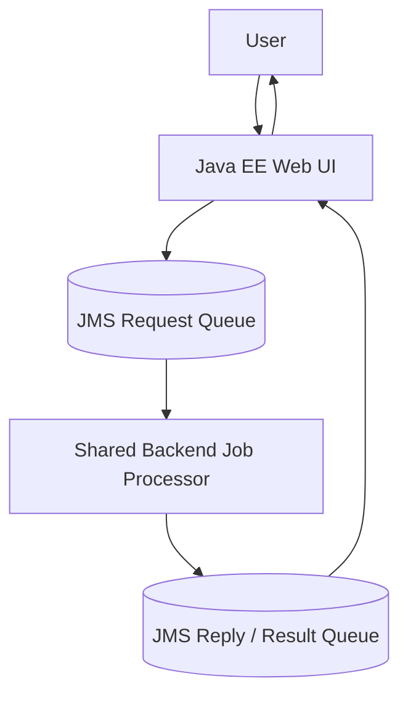
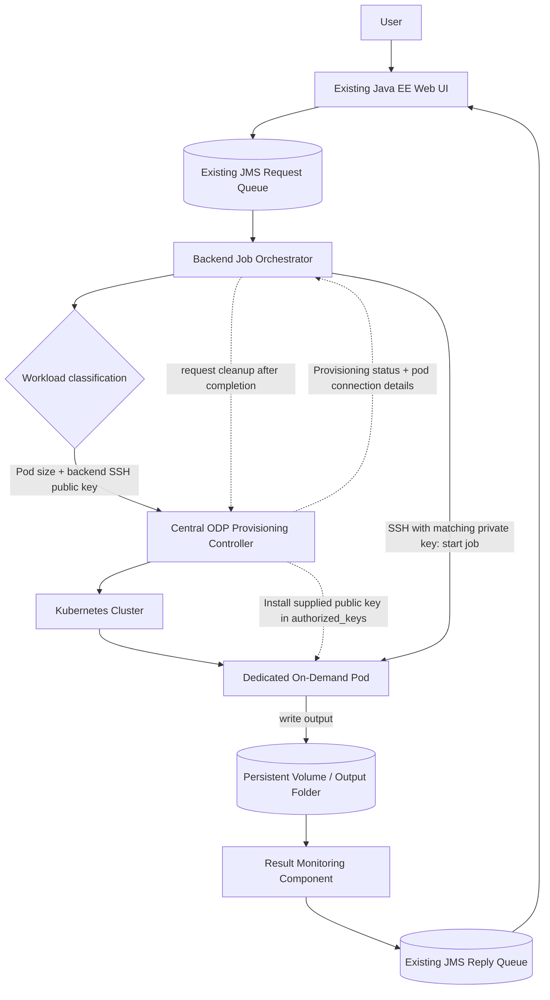
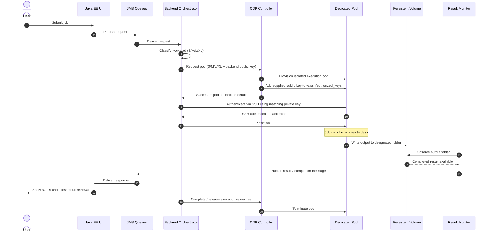

# SBB — On-Demand Pod (ODP) Architecture

**Modernising a legacy Java EE job-processing application with Kubernetes-based, on-demand execution**

> **Project overview:** This document describes the SBB On-Demand Pod (ODP) solution based on my recollection of the architecture and implementation. It is intended as a technical case study, not as official product documentation. Some operational details have been generalised.

## 1. Background

SBB was a Java EE application used to submit and execute operational tasks related to products. A user submitted a task through a web UI, and the backend processed it asynchronously. Depending on the task, execution could take **a few minutes to several days**.

The original application used **Java Message Service (JMS)** to decouple submission from execution:

1. A user submitted a request through the UI.
2. The application published a message to a JMS request queue.
3. A backend processor consumed the request and executed the task.
4. When finished, the backend published the result through JMS.
5. The UI showed the request status and allowed the user to retrieve the result.

This asynchronous interaction model worked well, but executing jobs in a conventional, long-running backend environment created challenges around workload isolation, capacity planning, and resource utilisation. Different tasks had very different CPU and memory requirements, and a large job could run for a prolonged period.

## 2. Modernisation objective

The goal was to **move job execution into isolated, dynamically provisioned Kubernetes pods** without rewriting the entire application.

We deliberately **kept the existing UI and JMS messaging flow**. The major change was in the backend execution layer: instead of processing a job in the shared backend runtime, it requested a dedicated **On-Demand Pod (ODP)** with resources appropriate to the workload.

Core design goals:

- **Preserve compatibility:** retain the existing UI and JMS request/response contract.
- **Isolate execution:** run each job in its own short-lived execution environment.
- **Right-size resources:** select a resource profile according to job requirements.
- **Support long-running jobs:** allow execution to continue independently of the UI session.
- **Persist results:** retain job output beyond the lifetime of the execution pod.
- **Release capacity:** clean up ephemeral compute resources after completion.

## 3. Architecture — before and after

### Legacy architecture

### ODP-based architecture

**Key architectural decision:** the UI and messaging interface stayed stable. Kubernetes was introduced behind the existing asynchronous processing boundary.

## 4. End-to-end execution flow

### Step 1 — Receive the request

The user submitted a product-related task through the existing UI. The application put the request on the JMS queue. The backend consumed the message and identified the required execution workload.

### Step 2 — Determine the required pod size

The backend included **workload classification logic** that selected one of four predefined resource profiles:

| Profile | Intended workload |
|---|---|
| **S** | Small / lightweight jobs |
| **M** | Medium jobs |
| **L** | Large / resource-intensive jobs |
| **XL** | Very large jobs |

The selected profile determined the requested execution capacity, primarily CPU and memory. The exact resource limits were environment-specific and are not reproduced here.

### Step 3 — Provision an on-demand pod

The backend called a **centralised ODP controller**, supplying the selected size (**S/M/L/XL**) **and the backend's SSH public key**. The controller used these inputs to create a dedicated Kubernetes execution pod. As part of provisioning, it placed the supplied public key in the execution user's `~/.ssh/authorized_keys` inside the pod, allowing that user account to accept SSH connections authenticated by the matching private key.

When provisioning succeeded, the controller returned the **pod connection details and success status**. It did **not** need to generate or return an SSH key pair: the backend already held the corresponding **private key**, which remained on the backend side and was not shared with the controller or the execution pod.

The key distinction is **public key sent to the controller; public key installed in the pod; private key retained by the backend for SSH authentication**.

### Step 4 — Execute the job remotely

Once the pod was ready and reachable, the backend used its **private key** to establish an SSH session with the pod. The pod's SSH server validated that authentication against the **public key previously installed in `authorized_keys`**. The backend then launched the requested job inside the pod.

This separated the **orchestration component** (receiving requests and managing execution) from the **execution environment** (running the actual workload).

A long-running task could execute in its dedicated pod without keeping the user's browser session open.

### Step 5 — Persist the result

The pod had a **Persistent Volume** mounted into its filesystem. When execution completed, the job wrote its output to a designated folder on that volume.

The persistent storage was important because the job result needed to survive termination of the short-lived pod. A separate component monitored the output location to detect completed results.

### Step 6 — Return the result through JMS

When the output became available, the monitoring/orchestration layer collected the result and sent the response back using the **existing JMS reply flow**.

The UI could then show that the job was complete and make the result available for retrieval. This preserved the user's original interaction pattern.

### Step 7 — Terminate and clean up

After the job finished and its output was safely available, the execution pod was terminated and its allocated compute resources were released.

The design therefore separated **ephemeral compute** (the ODP) from **persistent output** (the mounted volume).

## 5. Sequence diagram

> The diagram is a **logical flow**, not a packet-level trace. In particular, the exact component that triggered cleanup and the mechanism used to detect output-file readiness should be verified against source code or deployment manifests.

## 6. Component responsibilities

| Component | Responsibility |
|---|---|
| **Java EE UI** | Accept requests, present job status, and provide completed results. |
| **JMS request/reply queues** | Preserve asynchronous communication between UI and backend. |
| **Backend job orchestrator** | Consume requests, determine workload size, send its SSH public key during provisioning, retain the private key, and initiate remote execution. |
| **Workload sizing logic** | Map each task to an S, M, L, or XL resource profile. |
| **Central ODP controller** | Receive the requested size and backend SSH public key, provision a Kubernetes pod, install the public key in the execution user's `authorized_keys`, and manage the pod lifecycle. |
| **On-demand execution pod** | Run the requested job in an isolated, resource-bounded environment. |
| **Persistent Volume** | Store job output outside the ephemeral pod filesystem. |
| **Result monitor** | Observe the output location, collect results, and send completion responses through JMS. |

## 7. Why this design mattered

The modernisation focused on changing **where and how jobs were executed**, rather than replacing working application interfaces.

**Benefits of the approach:**

- **Incremental migration:** the existing UI and JMS integration remained intact, reducing the scope of change.
- **Workload isolation:** each job had a dedicated environment, reducing interference between unrelated tasks.
- **Better resource allocation:** the S/M/L/XL classification avoided assigning the same compute footprint to every task.
- **Elastic execution:** pods could be created when needed and removed when work completed.
- **Long-running workload support:** tasks lasting hours or days did not depend on a synchronous HTTP request.
- **Durable outputs:** persistent storage allowed results to be collected after the execution pod terminated.

These are architectural benefits of the design; this case study does **not** claim measured improvements in cost, throughput, or execution time without supporting benchmarks.

## 8. Important engineering considerations

The architecture also introduced operational concerns that should be addressed in a production implementation:

- **Pod readiness:** ensure SSH access and the required runtime are available before starting a job.
- **SSH key management:** keep the backend's private key confidential; send only its public key to the ODP controller. Ensure the execution pod configures `authorized_keys` with suitable filesystem permissions and does not expose the private key.
- **Idempotency:** avoid running the same job twice if JMS delivery is retried.
- **Job correlation:** associate JMS messages, pod identities, output folders, and results with a stable job ID.
- **Failure recovery:** handle provisioning failures, SSH timeouts, failed scripts, and lost connections.
- **Result completeness:** distinguish a fully written output file from a file that is still being written.
- **Cleanup and retention:** remove pods reliably while retaining output for the required period.
- **Resource controls:** enforce CPU/memory limits, quotas, and concurrency safeguards.

These are design considerations, not a claim that every mechanism was implemented in precisely this form.

## 9. Technology summary

| Area | Technology / pattern |
|---|---|
| Existing application | Java EE |
| Messaging | JMS queues |
| Orchestration | Backend request consumer and ODP controller |
| Container platform | Kubernetes |
| Workload sizing | S / M / L / XL resource profiles |
| Remote job execution | SSH public-key authentication; backend supplies public key at pod creation, uses matching private key for execution |
| Output storage | Kubernetes Persistent Volume / mounted output directory |
| Completion notification | Output monitoring and JMS reply |
| Lifecycle | Provision on demand → execute → persist result → terminate pod |

## 10. Project summary

**SBB ODP was an incremental cloud-native modernisation of a legacy, asynchronous Java EE job-processing system.** Rather than replacing the UI or JMS messaging architecture, we introduced a Kubernetes-based execution layer. The backend classified incoming work into S, M, L, and XL resource profiles, requested an appropriately sized pod from a central controller while supplying its SSH public key. The controller installed that public key in the pod's `authorized_keys`, enabling the backend to authenticate using its matching private key and launch the job over SSH. The isolated pod wrote its result to persistent storage, a monitoring component collected the result, and the application returned it through the existing JMS flow. Once execution finished, the pod was terminated and its compute resources released.

The central architectural idea was to **preserve the existing application contract while replacing shared, long-running job execution with isolated, on-demand compute**.

---

*This README is a retrospective architectural explanation. It intentionally excludes internal endpoints, secret material, environment-specific resource values, and proprietary deployment configuration.*
